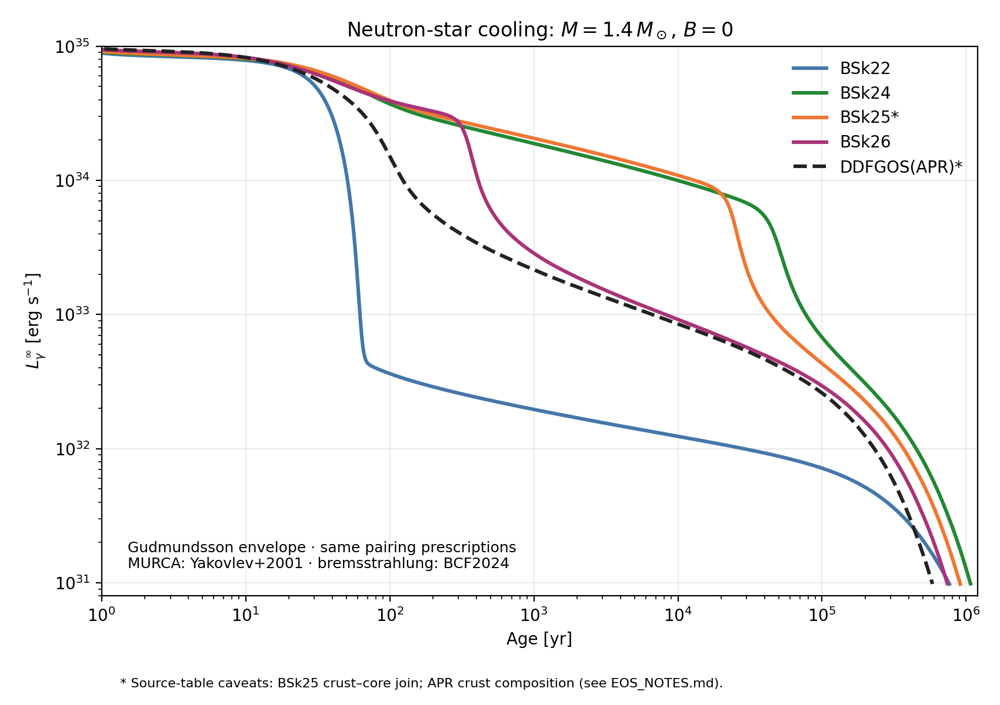
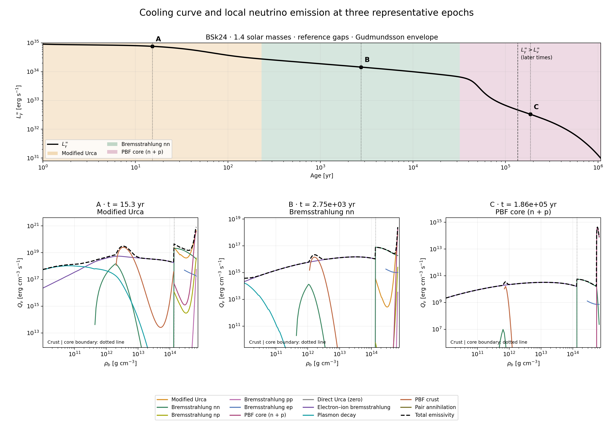

# Neutron-star cooling

One-dimensional, non-magnetic neutron-star thermal evolution on a cold relativistic stellar background. The repository contains the current Python cooling solver, five CompOSE EOS packages, reproducible numerical examples, and a working A&A-style review manuscript.

| Directory | Contents |
|---|---|
| [`code/`](code/README.md) | Solver, microphysics, EOS tables, input files and tests |
| [`examples/`](examples/README.md) | Python scripts, curated reference CSVs and figures |
| [`docs/`](docs/README.md) | User guide, numerical decisions and LaTeX article |

## Install and run

From the repository root, with Python 3.13 (or an existing compatible Python):

```bash
python3 -m venv .venv
source .venv/bin/activate
python -m pip install -r code/requirements.txt
python code/cooling_driver.py --no-animation --check-energy --out results/reference
```

The default model is **BSk24, 1.4 solar masses, mesh C, B = 0**, with the Gudmundsson envelope and reference pairing fits 7/12/8 (crust neutrons/core neutrons/core protons). Modified Urca uses the implemented Yakovlev et al. (2001) expressions; core nucleon bremsstrahlung uses Bottaro et al. The run stops below photon luminosity at infinity of 1e31 erg/s.

A shorter check:

```bash
python code/cooling_driver.py --no-animation --final-years 1000 --out results/short
```

Activate `.venv` in each new terminal. To open the project in VSCode, open `neutron-star-cooling.code-workspace`; select `.venv/bin/python` once if prompted.

## Reproduce the figures

Regenerate figures from committed data, without rerunning the cooling solver:

```bash
python examples/five_eos/plot.py
python examples/gap_scan/plot.py
python examples/neutrino_zones/plot.py
python examples/eos_tables/plot_pressure.py
python examples/eos_tables/plot_mu.py
```

The original data remain in each example's `reference/`; new files go to `results/`. See [examples](examples/README.md) to rerun the numerical calculations.





## Documentation and manuscript

- [User guide](docs/USER_GUIDE.md)
- [EOS decisions and limitations](docs/EOS_NOTES.md)
- [Reproducibility and validation](docs/REPRODUCIBILITY.md)
- [Compiled article](docs/article/main.pdf) and [LaTeX source](docs/article/main.tex)
- [GitHub setup instructions (Catalan)](GITHUB_SETUP.md)

The manuscript and calculations are a working research snapshot, not a fit to observational data. APR crust composition and the retained PBF-response approximation remain documented limitations. Energy closure does not establish spatial convergence or validate the microphysical prescriptions.

## Tests

```bash
python -m pip install -r code/requirements-dev.txt
python -m pytest -c code/pytest.ini code/tests -q
```

Slow convergence tests are skipped by default; use `-m slow` to select them or `-m ""` to include all tests. See `docs/VALIDATION.md` for checks performed on this packaged layout.

## Provenance

EOS provider files and their notices are retained unchanged. The BSk25/BSk26 row omissions apply only in the reader; APR retains its existing Maxwell density jump. See [licensing and attribution](LICENSE_NOTES.md) before assigning a project-wide licence. The bibliographic source map is included in the manuscript.
